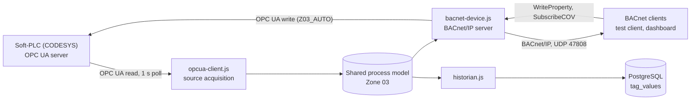

# opcua-bacnet-gateway

A software-only OPC UA to BACnet/IP gateway written in Node.js. It reads live process data from an industrial controller over OPC UA and exposes it as standard BACnet/IP objects that any BACnet client can discover, read, command, and subscribe to, with no gateway hardware in the data path.

The reference implementation uses a CODESYS soft-PLC running a small irrigation-zone simulation (Zone 03), but the pattern is not specific to water: any equipment reachable over OPC UA can be exposed to a building automation system this way.

> **Status:** working prototype and reference implementation. It has been validated from a separate machine using a BACnet client built on the same library as the gateway. It is not BTL-listed and has not yet been tested against a commercial BAS supervisory platform. See [Limitations](#limitations).

## Demo

[Watch the walkthrough video](VIDEO_URL)


*Figure 1. Three-level architecture. Level 1 (integration) is demonstrated; Level 2 is partially implemented; Level 3 is future work.*

## Contents

1. [What it does](#what-it-does)
2. [Architecture](#architecture)
3. [Point mapping](#point-mapping)
4. [BACnet services supported](#bacnet-services-supported)
5. [Quick start](#quick-start)
6. [Test client and dashboard](#test-client-and-dashboard)
7. [Reproducing the validation](#reproducing-the-validation)
8. [How it works](#how-it-works)
9. [Historian database](#historian-database)
10. [Troubleshooting](#troubleshooting)
11. [Limitations](#limitations)
12. [Roadmap](#roadmap)
13. [Security notes](#security-notes)
14. [License and contact](#license-and-contact)

## What it does

- **Acquires** live values from a PLC over OPC UA, polling once per second.
- **Exposes** them as BACnet/IP objects: analog inputs, binary values, and one commandable binary output.
- **Accepts commands** over BACnet and translates them into OPC UA writes, with a real 16-level priority array on the commandable point.
- **Pushes changes** to subscribed clients with Change-of-Value (COV) notifications instead of requiring polling.
- **Refuses writes** to read-only points with a standard BACnet error.
- **Logs** values and commands to a PostgreSQL historian.

## Architecture



The control logic stays in the PLC. The gateway only reads selected variables and writes the one permitted command point, so existing control, equipment protection, and interlocks are unchanged.

### Source files

| File | Role |
|---|---|
| `src/bacnet-device.js` | The BACnet/IP server: Who-Is, ReadProperty, WriteProperty, SubscribeCOV, COV notifications, priority arbitration, and the one-second sync loop |
| `src/device-object.js` | The in-memory BACnet object database and device instance (10003) |
| `src/opcua-client.js` | OPC UA connection, polling (`POLL_MS`), the shared Zone 03 state, and `writeTag` |
| `src/historian.js` | PostgreSQL logging (`initHistorian`, `ensureTag`, `logValue`) |
| `src/inspect-db.js`, `src/check-tags.js` | One-off scripts for inspecting the schema and recent values |
| `bacnet-test/` | Test client scripts and the web dashboard (run these on a separate machine) |

## Point mapping

The mapping is currently defined in code for a single zone.

| OPC UA variable | Type in PLC | BACnet object | Access | Notes |
|---|---|---|---|---|
| `Z03_FLOW` | REAL | Analog Input 1 (`Zone3_Flow`) | read-only | flow rate |
| `Z03_MOISTURE` | REAL | Analog Input 2 (`Zone3_Moisture`) | read-only | percent |
| `Z03_VALVE` | REAL (0 to 100) | Binary Value 1 (`Zone3_Valve`) | read-only | any non-zero value is reported as 1 (open) |
| `Z03_FAULT` | BOOL | Binary Value 2 (`Zone3_Fault`) | read-only | |
| `Z03_AUTO` | BOOL | Binary Output 1 (`Zone3_Auto`) | **commandable** | automatic operating mode, 16-level priority array |

The device object is instance **10003**, vendor identifier 999, object name `OPCUA-BACnet-Gateway`, on UDP port **47808**.

## BACnet services supported

| Service | Status |
|---|---|
| Who-Is / I-Am | Implemented |
| ReadProperty | Implemented, including Present_Value, Object_Name, Priority_Array, and Relinquish_Default |
| WriteProperty | Implemented for Binary Output 1 only; all other objects return WRITE_ACCESS_DENIED |
| SubscribeCOV | Implemented; an immediate notification is sent on subscribe, then one per change |
| COV notifications | Unconfirmed path tested; confirmed path implemented but not yet exercised |
| Priority_Array, relinquish | Implemented on Binary Output 1 (relinquish by writing Null) |

Not implemented, among others: ReadPropertyMultiple, WritePropertyMultiple, segmentation, alarm and event services, trend logs, schedules, COV increments, and BBMD or foreign-device registration.

## Quick start

### Requirements

- Node.js 18 or newer (tested on Node 22 and 24)
- PostgreSQL
- An OPC UA server exposing the variables above (the reference setup uses CODESYS)
- A **second machine or VM** for the BACnet client (see [Troubleshooting](#troubleshooting))

### Install

```bash
git clone https://github.com/Radfar/opcua-bacnet-gateway.git
cd opcua-bacnet-gateway
npm install
```

### Configure

Create a `.env` file in the project root (it is git-ignored; never commit it):

```
DB_HOST=localhost
DB_PORT=5432
DB_NAME=building_irrigation
DB_USER=postgres
DB_PASSWORD=change-me
```

Set the OPC UA endpoint, node identifiers, and `POLL_MS` in the constants at the top of `src/opcua-client.js`.

### Run

```bash
node src/bacnet-device.js
```

Expected output:

```
BACnet/IP Native Client-Server Stack Initialized
Exposing Device Instance: 10003 on UDP Port 47808
[Historian] Tag cache loaded, Z03_FAULT/Z03_AUTO ensured
Watching: Z03_FAULT, Z03_FLOW, Z03_MOISTURE, Z03_VALVE
Writable: Z03_AUTO
OPC UA connected, polling Zone 03
[Zone 03 -> BACnet] flow=0 moisture=0.00 valve=0 fault=false auto=false
```

Allow inbound UDP 47808 through the host firewall.

## Test client and dashboard

The scripts in `bacnet-test/` act as an independent BACnet client. Run them on a **separate machine or VM**.

```bash
cd bacnet-test
npm install node-bacnet express
```

Edit `HOST_IP` at the top of each script to the gateway host's address, then:

| Script | What it does |
|---|---|
| `node test-client.js` | Sends Who-Is, then reads the device Object_Name |
| `node write-test.js` | Tries a write to the read-only flow point (refused), then writes Zone3_Auto and reads it back |
| `node dashboard-server.js` | Subscribes to COV on all five points and serves a web dashboard on port 3001 |

The dashboard is a **test interface**, not a proposed operator interface. Its buttons exercise the priority array: Manual ON/OFF and Relinquish at priority 8, Automatic ON/OFF at priority 16.

## Reproducing the validation

| Capability | How to reproduce | Expected result |
|---|---|---|
| Discovery | `test-client.js` | I-Am for device 10003; the gateway logs a `[Discovery]` line |
| Read | `test-client.js` | Object_Name `OPCUA-BACnet-Gateway` |
| Write | `write-test.js` | `Write SUCCESS`; gateway logs `[OPC UA write] Z03_AUTO -> true`; `auto=true` follows and the flow ramps |
| Write refusal | `write-test.js` | `Correctly REJECTED: ... WRITE_ACCESS_DENIED`; gateway logs `REJECTED ... is not a commandable point` |
| COV | `dashboard-server.js` | Each point shows an initial value, then updates when values change; the client log prints only on change |
| Priority arbitration | Dashboard: Manual ON (P8), Automatic OFF (P16), Relinquish Manual (P8) | After the second click the point stays ON (`resolved=true (winning priority: 8)`, no OPC UA write); after the third it turns OFF (`resolved=false (winning priority: 16)`) |
| Historian | `node src/check-tags.js` | New `tag_values` rows each second for the Zone 03 tags |

## How it works

**Source acquisition.** `opcua-client.js` polls the Zone 03 variables once per second and holds them in a shared in-memory state.

**BACnet exposure.** A one-second sync loop in `bacnet-device.js` copies that state into the BACnet object database. For each point it compares the new value with the previous one and sends COV notifications to subscribers **only when the value changed**. COV is therefore generated by the gateway's own change detection, not by OPC UA subscription events. No COV increment is configured, so every change is reported.

**Commands and priority arbitration.** A WriteProperty to Binary Output 1 is stored in its 16-slot Priority_Array (default priority 16 when none is given). The effective value is the first non-empty slot from priority 1 downward, or Relinquish_Default if all are empty. Writing Null relinquishes a slot. Only a change in the effective value is written to OPC UA, so a lower-priority command that does not win never reaches the process.

**Stale-poll hold.** After a BACnet write, the gateway keeps the commanded value until the next OPC UA poll confirms it, or for at most five seconds, so a lagging poll cannot overwrite the command.

**COV subscriptions.** The gateway keeps a per-object subscriber list with lifetimes and sends one notification immediately on subscribe. Clients must renew before the lifetime expires (the dashboard renews every four minutes).

**Historian.** Every sync cycle logs the Zone 03 values to PostgreSQL, and accepted commands are logged too. `ensureTag` creates the `Z03_FAULT` and `Z03_AUTO` tag rows on first run.

## Historian database

The gateway writes to three tables:

```sql
CREATE TABLE IF NOT EXISTS equipment (
  id SERIAL PRIMARY KEY,
  tag_name VARCHAR, description VARCHAR, equipment_type VARCHAR,
  location VARCHAR, created_at TIMESTAMP DEFAULT now()
);
CREATE TABLE IF NOT EXISTS tags (
  id SERIAL PRIMARY KEY,
  equipment_id INTEGER, tag_name VARCHAR, description VARCHAR,
  data_type VARCHAR, unit VARCHAR, created_at TIMESTAMP DEFAULT now()
);
CREATE TABLE IF NOT EXISTS tag_values (
  id BIGSERIAL PRIMARY KEY,
  tag_id INTEGER, value NUMERIC, quality VARCHAR, "timestamp" TIMESTAMP DEFAULT now()
);
```

On a fresh database, seed the Zone 03 rows once. The gateway expects equipment id 8 for Zone 03 and the three measured tags to exist:

```sql
INSERT INTO equipment (id, tag_name, description, equipment_type, location)
VALUES (8, 'Z-03', 'Roof Garden Irrigation Zone', 'ZONE', 'Roof Garden');
INSERT INTO tags (equipment_id, tag_name, description, data_type, unit) VALUES
  (8, 'Z03_MOISTURE', 'Zone 03 soil moisture', 'FLOAT', '%'),
  (8, 'Z03_FLOW', 'Zone 03 irrigation flow', 'FLOAT', 'L/min'),
  (8, 'Z03_VALVE', 'Zone 03 valve position', 'FLOAT', '%');
```

Adjust the table definitions if you reuse an existing database. If you also run another historian against the same database, do not write to its own tables.

## Troubleshooting

- **No response from the client on the same machine.** Two BACnet/IP stacks cannot both bind UDP 47808 on one host. Run clients on a separate machine or VM.
- **ERR_TIMEOUT on the first read.** Check that UDP 47808 is allowed through the gateway host's firewall, and that `HOST_IP` is correct.
- **Who-Is gets no answer across subnets.** Broadcasts do not cross NAT or routers. Read the device directly by IP address.
- **Database errors at startup.** The `.env` file must be loaded before `historian.js` is required, and its values must be complete.
- **Duplicate historian rows.** Make sure only one gateway process is running.
- **Dashboard stops updating after about five minutes.** A COV subscription lifetime has expired; the dashboard renews every four minutes, so check that it is still running.

## Limitations

Stated plainly, so nobody has to find them by surprise:

- **One zone, mapping defined in code.** There is no configuration file for points yet.
- **Priority array and COV subscriptions are held in memory.** Command state and subscriptions are lost when the gateway restarts.
- **Source loss.** The gateway keeps the last good values and does not mark them as unreliable (no Status_Flags or Reliability handling).
- **Same library on both ends.** The test client uses the same BACnet library as the gateway, so a shared library defect could go undetected.
- **No commercial supervisor testing.** Interoperability with an established BAS platform has not been evaluated.
- **No BACnet conformance claim.** The project is not BTL-listed; sustained operation, scale, and cybersecurity have not been evaluated.
- **COV has no increment or deadband.** Every change is reported.
- **To verify:** the engineering-units code set on `Zone3_Flow` should be checked against the BACnet units table (liters per minute is the intended unit).

## Roadmap

Following the three levels in Figure 1:

- **Level 1:** a point-mapping file, additional source adapters, BACnet Secure Connect (BACnet/SC), source-loss quality flags, persisted command state, and testing against a commercial BAS supervisor.
- **Level 2:** a fuller application layer on top of the integration boundary (equipment views, navigation, dashboards, historical access).
- **Level 3:** analytics and AI-assisted diagnostics on historian data, a formal semantic data model, digital-twin applications, and structured interfaces such as MCP for AI services.

## Security notes

- BACnet/IP has no built-in authentication. Do not expose UDP 47808 to untrusted networks.
- The gateway can write to a PLC variable. Restrict network access to it, and keep the writable set as small as possible.
- Keep `.env` out of version control, and use a dedicated, least-privileged database user.
- Write-access enforcement in this project is a point-level restriction, not a user authentication or access-control model.

## License and contact

See [LICENSE](LICENSE).

Alireza Radfar, Industrial Automation Engineer. [LinkedIn](https://www.linkedin.com/in/arradfar/)
